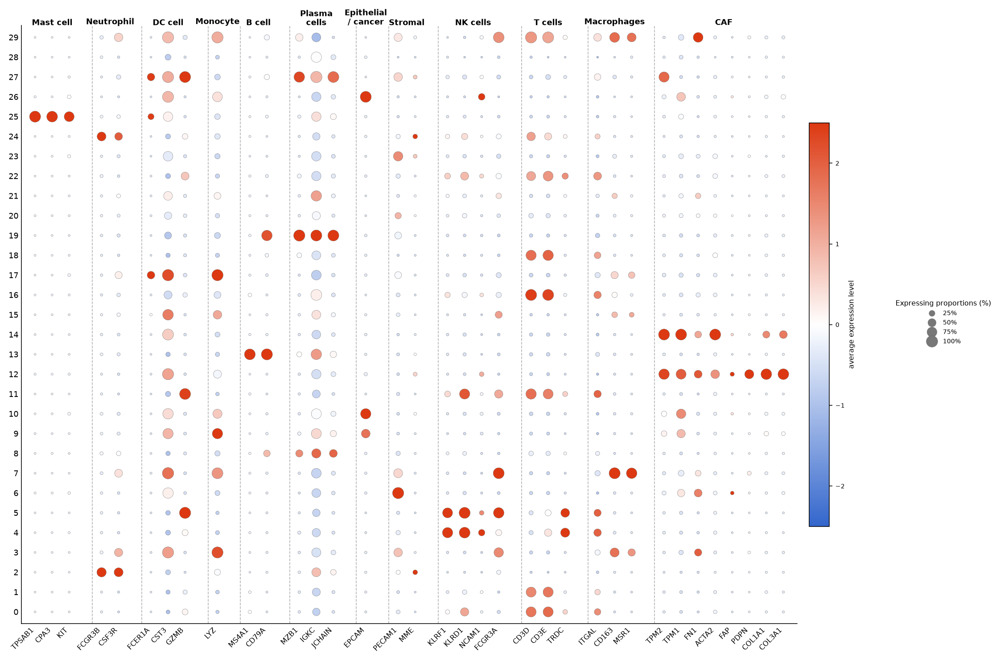

# dsh-singlecell-workbench — 单细胞分析工作台（DeepSeek Harness 插件）

在 Harness Web GUI 里提供一个**可视化、可点、可被 Agent 驱动**的单细胞分析工作台：
导入数据（GEO 上能下到的格式 + R 的 `.rds`/`.RData`）→ 跑标准流程（QC/过滤/标准化/HVG/PCA/聚类/嵌入/标记基因）→
看交互式嵌入图与出版级图 → 自动注释 → 自检 → **一整套高级分析** → 导出可复现产物。

设计对齐 [Claude Science](https://www.anthropic.com/news/claude-science-ai-workbench)、
[Claude for Life Sciences](https://www.anthropic.com/news/claude-for-life-sciences) 这类成熟方案：
**每个产物都有可审计的历史与运行环境、有确定性复核、有可复用预设流程、可视化产物可交互迭代、参数可对比**。
单细胞领域沿用 CellxGene 的交互嵌入、Cellenics/Galaxy 的流程卡片与历史、CellMarker/PanglaoDB 式参考 marker 面板、scanpy 最佳实践。

## UI：步骤向导式工作台（v0.9）

不再是 7 个横向 tab，而是按「单细胞分析器」的步骤向导：

- **欢迎页**（无数据）：导入 / 示例 / 最近数据集；**顶栏**：数据集选择器 · 导入 · 刷新 · 引擎状态 · ☰ 运行日志 / 🤖 Agent 抽屉
- **左侧步骤导航**：01 数据读取·分组·质控 → 02 降维聚类 → 03 细胞标注 → 04 高级分析·结果（状态点：未开始/进行中/已完成/warning）
- **Step1**：扫描根目录导入 + 样本&分组编辑 + QC 参数卡（pro.R 参数）+ QC/过滤运行
- **Step2**：Seurat6 + IntegrateLayers（Harmony/RPCA/未整合）三套预设一键跑 + resolution 滑块 + 交互 UMAP + 三套结果对比 + warnings；**高变基因数收进「进阶/参考参数」折叠区**（默认 3000，对齐 pro.R，仅作参考）
- **Step3（三段式）**：① 先输入「细胞类型 + marker 基因」方案（含人/鼠内置参考方案、粘贴 CSV）→ ② 按键出 **DotPlot/热图**（按类型分组+分隔线）与 **FeaturePlot** → ③ 最后把每个 cluster 分配给细胞类型保存注释（注释表/覆盖率/按注释着色）；可提取为小亚群二次聚类
- **Step4**：分组结果画廊（lightbox）+ 高级分析目录 + 记录 + 导出（h5ad/protocol/methods/report/script）
- 右侧抽屉：运行日志 + Agent（输入一句话 → 建议卡 → 直接运行）；保留「进阶：逐步运行」折叠区；移动端单列

## 一、数据导入：GEO 上能下到的格式都能读

| 格式 | 扩展名/形态 | 说明 |
|---|---|---|
| AnnData | `.h5ad`（含 `.gz`） | scverse/scanpy 标准 |
| 10x Genomics HDF5 | `.h5` | CellRanger `filtered/raw_feature_bc_matrix.h5`；自动只留 Gene Expression |
| 10x Matrix Market | 目录三件套 或 单个 `.mtx(.gz)` | `matrix.mtx + barcodes.tsv + features/genes.tsv`；缺 sidecar 时自动生成名 |
| Loom | `.loom` | GEO 常见（HDF5 原生解析，不用 loompy） |
| 表达矩阵文本 | `.csv/.tsv/.txt`（含 `.gz/.bz2`） | 分隔符嗅探、表头/行名识别、**方向自动判断**（barcode vs 基因符号），可用 `transpose` 强制 |
| GEO series matrix | `*_series_matrix.txt.gz` | 解析 `!series_matrix_table_begin` 段 + `!Sample_*` 元数据 |
| R 对象 | `.rds` | Seurat v3/v4/v5、SingleCellExperiment、Matrix/dgCMatrix、data.frame（R 桥，本机 R 4.4.2 + Seurat 5.4） |
| R 工作空间 | `.RData` / `.rda` | 自动挑 Seurat/SCE；多对象时列出候选，用 `object` 指定 |
| 压缩包 | `.zip/.tar/.tar.gz/.tgz` | 自动找 10x 三件套或唯一数据文件；多候选时列出来选（防路径穿越、20GB 上限） |
| URL | `http(s)://`、`ftp://`、GEO `GSE12345` | GEO FTP 直链下载后自动识别；给 GSE 号会列出 supplement 文件再选（8GB 上限） |

打开方式（页面顶栏「导入数据」或对话里让 Agent 做）：

```
用单细胞工作台打开 /Users/you/data/GSE123456_10x/     # 目录三件套
用单细胞工作台打开 /Users/you/objects/neu_clean.rds   # Seurat 对象
用单细胞工作台打开 https://ftp.ncbi.nlm.nih.gov/geo/series/GSE123nnn/GSE123456/suppl/GSE123456_raw.tar.gz
```

R 对象会带上原始 `obs` 元数据（`seurat_clusters`、`celltype`、`group`、`percent.mt` 等），可直接用于着色与组间分析。

## 二、标准流程（可视化 + 可重跑）

左栏 10 张流程卡片：质控 → 过滤 → 标准化 → HVG → PCA → 邻接图 → 聚类 → 二维嵌入 → 标记基因 → 细胞类型注释。
每张卡可改参数、可重跑、有依赖提示；完成后回填一行摘要。中栏 6 个 tab：

- **嵌入图**：canvas 交互散点（滚轮缩放/拖拽/双击复位/悬停 tooltip/图例点选高亮），可按 cluster、cell_type、QC 指标、任意基因或**分析写回的 obs 列**（伪时间、细胞周期相位、regulon 活性…）着色
- **QC**：小提琴图 / 散点图（按需生成）
- **标记基因**：每簇 top marker 表（logFC、BH 校正 p、表达比例）+ dot plot / heatmap
- **聚类**：簇大小柱状图 + 逐簇改细胞类型名
- **记录**：数据集历史（每步参数/耗时/引擎版本/种子）、自检、自动注释、分辨率扫描、导出
- **高级分析**：见下

辅助能力：**自动注释**（内置 ≥14 类参考 marker 面板，给 top1/top2 + margin + 证据基因）、**自检**（10 项确定性检查，0–100 分）、**分辨率扫描**（多 resolution 的簇数与 ARI）、**预设流程**（standard/quick/qc 一键跑）。

## 二·五 降维聚类：对齐你的 Seurat 5.0 pro.R

按你 `Suerat5.0降维版本 pro.R` 的官方写法实现（Seurat 6.0 独立库，不改系统）：

- **QC**：nFeature 200–5000、percent.mt < 20、nCount > 500、min.cells=3（预设 `seurat6` 已带上）
- **预处理**：LogNormalize → FindVariableFeatures(vst, **3000**) → ScaleData → RunPCA(**30**)
- **批次整合**：`IntegrateLayers` 官方接口，`HarmonyIntegration` / `RPCAIntegration`（按 sample/orig.ident/batch 自动识别批次列，可手动指定）；RPCA 小样本自动调 `k.weight`、失败时回退 Harmony 并如实标注
- **三套结果**（对应 pro.R 的三套聚类）：
  - `seurat6`（Harmony，resolution **0.8**，dims 1:30）
  - `pro-rpca`（RPCA，resolution **0.8**）
  - `pro-unintegrated`（未整合 PCA，resolution **0.5**）
  在「聚类」tab 的降维聚类卡片里选预设/调滑块即可，聚类数 20–30 提示
- UMAP：dims 1:30、n.neighbors 30、metric euclidean（Seurat 默认）
- **不再静默下采样**（默认 200000 细胞）

> 修复记录：按样本 merge 构建多层对象会打乱细胞顺序导致簇标签错位（ARI≈0），已改为单对象 + split 分层整合；回归 241/241，demo ARI 0.8962（vs 内置）/ 1.0000（vs 真值）。

## 二·六 手动注释工作台 / 样本分组维护 / Agent 输入式建议（v0.6）

**手动注释工作台**（「标记基因」tab 顶部）：
- 左列每簇一行（top3 基因），点簇 → marker 表（gene/logFC/padj/pct_in），点基因选中；
- 出图：**DotPlot / 热图 / FeaturePlot**——dotplot/heatmap 支持按**你选中的基因**出图（`params.genes`，不再只按每簇 top-N），FeaturePlot 自动切到嵌入图并按该基因着色；
- 每簇填细胞类型 → [保存注释]（`run annotate mapping`），也可**粘贴注释表 CSV**批量应用。

**样本 & 分组维护**（「记录」tab）：
- 分组 chip 可删除（仍被样本使用时禁用并提示）、分组下拉含「— 清空分组 —」；
- **[移除样本]** 现在会**真正剔除该样本细胞**（`POST /samples/remove`），并自动重置聚类/嵌入等下游结果，提示重新一键降维聚类。

**Agent 面板输入式建议**（右栏顶部）：
- 输入一句话（如「加 harmony」「resolution 调到 0.3」「找 marker」「组间差异」「导出报告」）→ 本地规则解析出 2–4 张建议卡，每张带 **[直接运行]** 与 [复制指令]；
- 直接运行对应 `/recipe /run /markers /plot /embedding /analysis /audit /export`，完成后刷新状态并显示结果摘要。


### 点图样式（对齐「点图plus版.r」）

Step3「看表达 → 出 DotPlot」默认就是这套样式：

- **基因按细胞类型分面**（列），粗体类型标题 + 自动换行 + 组间分隔线
- **行 = cluster**；点大小 = 表达比例（图例 25/50/75/100%）；颜色 = 按基因 z-score 的 **蓝-白-红**（#3366CC → #FFFFFF → #DC3912，图例 average expression level）
- 坐标轴无标题、基因名 45° 旋转



## 三、高级分析（能力图全量登记）

「高级分析」tab 按 7 大类列出全部条目。**原生分析**（下面标 native）在本机零配置可跑；**外部工具**灰显并给出原因与本插件替代方案，不会伪装成可运行。

| 组 | 原生态分析（可跑） | 外部工具（已登记，给替代方案） |
|---|---|---|
| 基本分析 | 细胞周期评分、亚型细分、多样本整合/批次效应校正 | scRNA-seq 污染校正（SoupX/DecontX） |
| 组间对比 | 组间细胞类型比例差异、同细胞类型组间差异基因 | — |
| 数据可视化 | 火山图、比例桑基图、差异基因 Featureplot/Vlnplot/dotplot/heatmap | — |
| 通路分析 | GO/KEGG 富集（内置 GMT + 用户 gmt + 可选 Enrichr 在线）、GSEA、GSVA 式通路活性 | — |
| 基因集合分析 | AUCell 式基因集打分、cNMF 表达程序、WGCNA 式共表达模块、基因集分数联合元数据 | — |
| 发育轨迹分析 | 扩散伪时间（monocle-like）、簇级轨迹图（PAGA-like）、熵干性分析、CytoTRACE 式分化潜能 | Monocle 官方实现、Palantir、RNA velocity（需 spliced/unspliced） |
| 肿瘤异质性分析 | CNV 信号（inferCNV 代理，可给基因位置则按染色体排序）、CNV 进化树、ITH_score | inferCNV 官方、CopyKAT |
| 细胞通讯分析 | 细胞通讯（内置 ~170 对配体-受体，CellChat/NATMI-lite） | NicheNet、CellPhoneDB、CellChat 官方 |
| 转录调控分析 | SCENIC-lite（内置 TF 列表 + 共表达靶基因 + AUCell 式活性） | pySCENIC、SCENIC、ARACNe-AP |
| 虚拟敲除 | 虚拟敲除、虚拟过表达、虚拟筛选（GRN 传播） | CellOracle、RegVelo |

**诚实说明**：标 `lite`/代理的都是本插件用表达矩阵做的重实现，不等同于官方工具结果；`method` 字段会写明实现方式。
真正依赖外部数据/工具的分析（RNA velocity 需要剪接计数、pySCENIC 需要 motif 数据库等）只登记 + 给指引，不在此假装可跑。

分析结果会以表 + 图呈现，部分分析（细胞周期、伪时间、CNV、regulon 等）把新列写回 `obs`，立刻可在嵌入图里着色。

## 四、Agent 驱动（与页面同一套实现）

Host 注册 `singlecell` 工具，Agent 与页面按钮共用 `lib/impl.mjs` 的操作实现；系统提示会带上工作台与当前数据集状态。

```
用单细胞工作台载入示例数据，跑到聚类，给细胞类型建议，再按 group 做组间比例差异和差异基因
用工作台打开 neu_analysis/objects/neu_clean.rds，用 celltype 着色看嵌入，然后跑队列细胞周期和 SCENIC-lite
把当前数据跑一下 GSEA（用内置通路集），再导出 report
```

常用 action：`status / demo / open / inspect / preview / run / embedding / markers / autoannotate / audit /
resolution_scan / recipe / analyses / analysis / plot / export / close / reset`。
`open` 的格式参数名是 **`data_format`**（不是 `format` —— `format` 是 JSON Schema 保留字，会让工具 schema 非法，见 `CONTRACT.md` 注意事项）。

## 五、溯源与导出（可审计产物）

| 文件 | 内容 |
|---|---|
| `protocol.json` | 数据来源、格式、维度、完整步骤历史（参数/耗时/引擎版本/种子）、图片清单、插件版本、跑过的分析 |
| `methods.md` | 英文 Methods 段落（步骤 + 参数 + 软件版本 + 阈值），可直接进论文 |
| `report.md` | 报告：摘要 + Methods + 图（同目录 PNG）+ top markers 表 + 自动注释建议 + 自检结果 |
| `script.py` | scanpy 风格可复现脚本（builtin 模式注明等价参数） |
| `*.h5ad` | 含 `obs`（clusters/cell_type/分析列）、`obsm`（X_pca/X_emb）、`X`、`layers["counts"]` |

## 六、安装与环境

插件已安装在本机 desktop profile（`dsh-singlecell-workbench` bundle，linked 安装，改代码即生效）。
重装：让 Agent 执行 `plugin_manager install_bundle target=<绝对路径>`；替换版本需先 `remove_bundle`。

- **Python**：3.10+，需要 `numpy pandas scipy scikit-learn anndata matplotlib h5py`。检测到 scanpy 会自动切 scanpy 模式（Leiden/UMAP），否则用内置引擎（纯 Python Louvain + t-SNE）。
- **R**（仅 `.rds`/`.RData` 需要）：R 4.x + `Seurat`/`SeuratObject`/`SingleCellExperiment`/`SummarizedExperiment`/`Matrix`。本机已验证 R 4.4.2 + Seurat 5.4.0。
- Host 按 `config.python` → `DSH_SINGLECELL_PYTHON` → PATH `python3` → macOS 框架版 → Homebrew → 系统 Python 顺序探测；R 按 `/usr/local/bin/Rscript`、框架版、PATH 探测。
- 数据与计算全在本机：Python worker 是本机子进程，HTTP 路由只接受回环地址。

配置（`cordis.patch.yml`）：

```yaml
- id: dsh-singlecell-workbench
  name: dsh-singlecell-workbench
  config:
    python: /opt/homebrew/bin/python3   # 可选
    workdir: /tmp/my-sc-workdir         # 可选（导入解包/图/导出都在这里）
    timeoutMs: 180000                   # 可选
```

## 七、架构

```
浏览器 client.js（React，main 槽 key=singlecell + sidebar.panellist）
   │ 同源 fetch /singlecell/*（前缀路由，加接口不需要重载 Host）
   ▼
Host index.js → lib/impl.mjs（唯一操作实现 + 路由 + Agent 工具 + prompt section）
   │ JSON-lines stdio
   ▼
Python worker lib/sc_engine.py（长驻，数据集常驻内存）
   ├─ lib/sc_io.py            全格式导入（h5ad/10x/loom/mtx/文本/GEO/压缩包/URL）+ R 桥 lib/r_bridge.R
   ├─ lib/analysis_registry.py 高级分析目录/ctx/分发 + 外部项登记
   ├─ lib/sc_analyses_sets.py  基因集/通路/矩阵类分析
   └─ lib/sc_analyses_dynamics.py 整合/轨迹/异质性/通讯/调控/虚拟敲除
```

## 八、故障排查

| 现象 | 处理 |
|---|---|
| 「Python 环境未就绪」 | 按提示装依赖，或在 config 指定 `python` |
| `.rds` 报没有 Rscript | 安装 R 与 Seurat/SeuratObject；或先用 R 转成 h5ad |
| `.RData` 提示多个对象 | 在导入面板/工具参数里传 `object`（候选会列出来） |
| 压缩包提示多个候选 | 传 `member` 选相对路径 |
| 10x h5 只读到部分基因 | 自动只保留 Gene Expression；raw 矩阵含全部 feature 属正常 |
| 图看不到 | 重新生成；临时目录被清理后旧图会失效 |
| 分析显示"不可用" | 看 reason：通常需要先聚类 / 数据缺分组列 / 缺基因位置文件 |
| 工具 schema 报 Invalid schema | 参数名不要用 JSON Schema 保留字（如 `format`），见 CONTRACT |

## 九、限制（诚实声明）

- 内置引擎不含双细胞去除、批次校正的官方实现（整合是本插件 ComBat/BBKNN 式近似）、细胞周期回归。
- 高级分析中标 lite/代理的是**本插件实现**，不是官方工具（pySCENIC/CellChat/NicheNet/inferCNV/CellOracle 等）的同款结果；对这些结果请谨慎解释。
- RNA velocity、monocle/Palantir 官方实现、NicheNet/CellPhoneDB、SCENIC 官方、CellOracle/RegVelo、CopyKAT、SoupX/DecontX 需要外部工具或额外数据，本插件不内置，只在分析目录里登记并给替代方案。
- 自动注释基于内置参考面板，只是建议；自检是确定性规则检查，不是第二模型复核。
- 大矩阵内存占用随数据量增长（常驻 worker）；`close`/`reset` 可释放。

## 十、官方工具桥（本机官方实现，非 lite）

插件会**自动探测本机已装的官方工具**并接入「高级分析」：装了就显示可运行、显示真实版本；没装显示原因。
当前实测可用（demo-pbmc 2208×1200，真实调用非模拟）：

| 官方工具 | 实测耗时 | 产出 |
|---|---|---|
| Seurat **6.0.0**（独立 R 库，不动系统 5.4） | full 4.4s / 预设 8.5s | PCA+聚类+UMAP 写回，ARI 对真值 1.0 |
| CellChat 1.6.1 | 5.9s | 通讯表 + obs 强度 + 2 图 |
| monocle3 1.3.7 | 11.3s | 伪时间/partition 写 obs + 2 图 |
| clusterProfiler 4.14.6（GO/KEGG） | 31.4s | 真 GO/KEGG 条目 + 2 图 |
| fgsea 1.32.4 | 2.4s | NES/p + 2 图 |
| GSVA 2.0.7 | 10.4s | 通路活性写 obs |
| AUCell 1.28.0 | 4.7s | 基因集 AUC 写 obs |
| harmony 1.2.4（也用于 Seurat 流程内批次整合） | 4.6s | 修正分量写 obs |
| CellPhoneDB 5.0.1 | 4.3s | 官方置换检验通讯表 |
| pySCENIC 0.12.1 | 48.3s | GRNBoost2 21582 边/12 regulon 写 obs |
| slingshot 2.14.0 | 4.1s | 谱系伪时间写 obs |
| NicheNet (nichenetr 2.2) | 20.9s | sender→receiver 配体活性表 + 2 图 |
| CellOracle 0.20.0（虚拟敲除） | 25.0s | in silico KO（如 IRF8）受影响基因 + 2 图 |

配置项（`cordis.patch.yml` 的 config）：`externalPython`（默认 `/opt/miniconda3/bin/python3`）、`Rscript`、`seuratLib`（默认 `~/.dsh/sc-plugin-rlib`）、`scenicMotifDb`、`nichenetPriors`、`regveloPython`。
诚实说明：`lite` 版分析仍保留（如 `gsva_like`/`cnv_score`/`virtual_knockout`），与官方版**并存且分列显示**；官方版 method 字段写明真实包名版本。当前尚未接入：inferCNV（Bioc 安装失败，JAGS 已装）、regVelo（需独立 Python 3.11 环境，安装中）、SoupX/copyKAT（R 包已装、适配器待补）、SCENIC(R)（实测中）。
