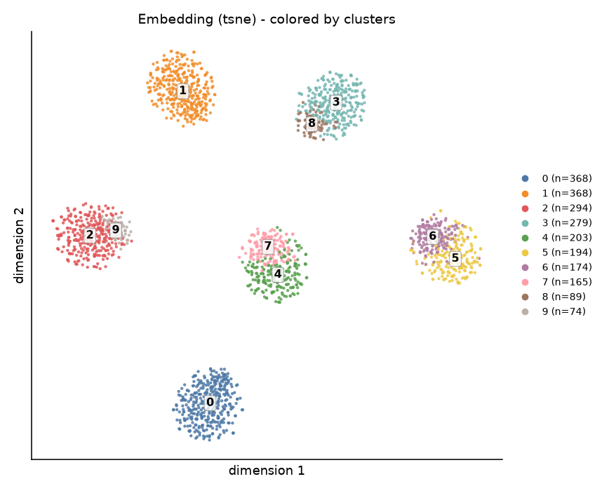
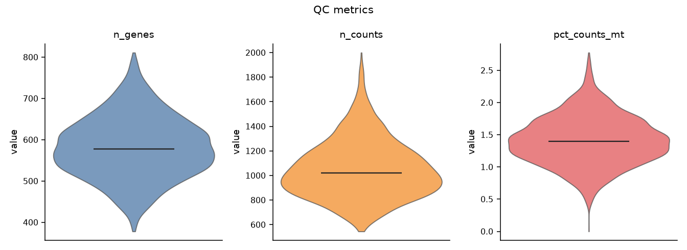
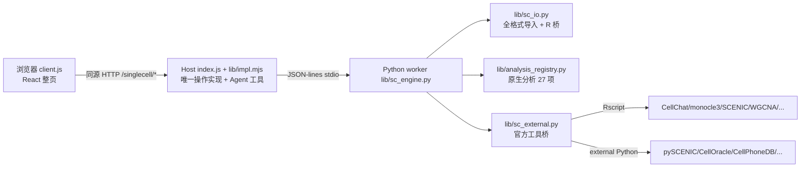

# dsh-singlecell — 单细胞分析工作台（DeepSeek Harness 插件）

> **把单细胞分析从「写脚本 + 配环境 + 查报错」变成「点几下 + 说一句话」。**
> 面向生物信息学小白与代码苦手：GEO 数据一键导入、可视化流程点着跑、官方 R/Python 工具零配置调用、Agent 与界面共用一套操作。

<p align="center">
  
</p>

## 为什么做这个

生信入门真正的门槛不是算法，而是：

1. **数据格式劝退**：GEO 上同一个数据集能给你 10x 三件套、`.h5`、`.loom`、`series_matrix.txt.gz`、CSV、Seurat `.rds`、`.RData`、压缩包……每个都要查一遍教程。
2. **环境劝退**：R 要装 Seurat/SeuratObject/Bioconductor，Python 要装 scanpy/anndata，版本冲突能耗掉一天。
3. **分组劝退**：GEO 常常「一个 GSM 一个文件」，样本名和大组信息只在文件名里，组间比较无从下手。
4. **高级分析劝退**：CellChat、monocle3、SCENIC、NicheNet、inferCNV……每个工具一套 API、一篇教程。
5. **Agent 不会用**：大模型能写代码，但它不知道你的环境装了什么、工作台里有什么数据。

**dsh-singlecell 把上面五件事全接进 DeepSeek Harness Web GUI**：界面给不写代码的人，Agent 工具给想偷懒的人，同一套实现。

## 功能一览

### 1. 导入：GEO 上能下到的格式都能读

| 格式 | 说明 |
|---|---|
| `.h5ad` | AnnData 标准格式 |
| 10x `.h5` | CellRanger filtered/raw，自动只留 Gene Expression |
| 10x Matrix Market | 三件套目录 / 单个 `.mtx(.gz)` |
| `.loom` | GEO 常见，h5py 原生解析 |
| CSV/TSV/TXT（可 `.gz`） | 自动判分隔符、表头、矩阵方向 |
| GEO `series_matrix.txt.gz` | 解析 `!Sample_*` 元数据 |
| **Seurat `.rds`** | Seurat v3/v4/v5、SingleCellExperiment、Matrix、data.frame |
| **`.RData` / `.rda`** | 多对象自动列候选，选定即读 |
| `.zip/.tar/.tar.gz` | 自动找 10x 三件套或唯一数据文件 |
| URL / GEO `GSExxxxx` | 直链下载；给 GSE 号会列 supplement 文件再选 |

**多文件合并导入**：一次选多个 `GSM*.csv.gz`（或目录），每个文件=一个样本，自动生成 `sample` 列，基因取交集。

### 2. 样本 & 分组编辑器（不需要写一行代码）

- 表格逐行改**样本名**、指定**大组**（young/old、GC/LM…可新建）；
- 按文件名正则**批量自动分组**（如 `(GC|LM)`）；
- 导入「样本→大组」对照 CSV；
- 导入细胞级 metadata CSV（按 barcode join，显示匹配率）；
- 设置分组列后，所有组间分析自动使用它。

<p align="center"></p>

### 3. 可视化流程（10 步，点着跑）

QC → 过滤 → 标准化 → 高变基因 → PCA → 邻接图 → 聚类 → 二维嵌入 → 标记基因 → 细胞类型注释。

- 每步可改参数、可重跑、有依赖检查；
- 交互式嵌入图：缩放/拖拽/悬停/按基因或任意元数据着色；
- 自检（10 项，0–100 分）、自动注释建议、分辨率扫描、预设流程一键跑；
- **降维可切 Seurat 6.0 官方流程**（`seurat6` 预设）。

### 4. 高级分析：27 项原生 + 17 项官方工具

原生（本插件实现，无需额外依赖）：细胞周期、亚型细分、批次校正、组间比例差异、组间差异基因、火山图、桑基图、GO/KEGG、GSEA、GSVA、AUCell、cNMF、WGCNA、伪时间、PAGA、熵干性、CytoTRACE、CNV/ITH、配体-受体通讯、SCENIC-lite、虚拟敲除/过表达/筛选。

本机装了官方工具就**自动调用官方实现**（显示真实版本）：

| 官方工具 | 实测 |
|---|---|
| Seurat 6.0.0（独立库，不动系统版本） | 4.4s |
| CellChat 1.6.1 | 5.9s |
| monocle3 1.3.7 | 11.3s |
| NicheNet 2.2 | 20.9s |
| SCENIC(R) 1.3.1 | 192s |
| clusterProfiler / fgsea / GSVA / AUCell / WGCNA | 2–108s |
| harmony / slingshot / CellPhoneDB / pySCENIC | 4–48s |
| CellOracle（虚拟敲除）/ CopyKAT / SoupX | 2–25s |

> 官方版与 lite 版**并存且明确标注**：官方版 method 写真实包名版本；lite 版写「本插件实现」。做不了的（如 inferCNV 安装失败、无 spliced 层的 RNA velocity）会直接显示原因，**不伪造结果**。

### 5. 可审计产物

每步 run 记录参数、耗时、引擎版本、随机种子；可导出：

- `protocol.json`（完整溯源）
- `methods.md`（英文 Methods，可直接进论文）
- `report.md`（摘要 + 图 + marker 表 + 自检）
- `script.py`（scanpy 风格复现脚本）
- `.h5ad`（含 clusters/cell_type/obsm/layers）

### 6. Agent 双入口

页面按钮与 Agent 工具**共用同一套实现**（`lib/impl.mjs` 的 op 函数）。对话里可以直接说：

> 用单细胞工作台把这几个 GSM 文件合并导入，样本名改成 GC1/GC2/LM1，分组 young/old，跑 Seurat 6.0 流程，然后按 group 做组间差异基因和通讯分析

Agent 会调 `singlecell` 工具完成，并在左栏实时看到同样的状态与图。

## 快速开始

### 环境要求

- DeepSeek Harness（Web GUI）
- Python 3.10+：`numpy pandas scipy scikit-learn anndata h5py matplotlib`
- 可选 R 4.x + `Seurat`/`SeuratObject`/`SingleCellExperiment`（只有读 `.rds/.RData` 才需要）
- 可选：安装官方工具（CellChat/monocle3/SCENIC/…），插件会自动探测并接入

### 安装

```bash
git clone https://github.com/<you>/dsh-singlecell.git ~/dsh-plugins/dsh-singlecell
cd ~/dsh-plugins/dsh-singlecell
python3 -m pip install -r requirements.txt
```

在 Harness 会话里对 Agent 说（会请求确认）：

> plugin_manager install_bundle target=/绝对路径/dsh-singlecell

看到 `application: applied` 即成功；刷新页面，侧边栏出现「单细胞」。详见 [INSTALL.md](INSTALL.md)。

### 三步上手

1. 顶栏「导入数据」→ 多行粘贴 GSM 文件路径（或勾「目录合并」）→ 导入；
2. 「记录」→「样本 & 分组」→ 改样本名、选大组 → 保存分组；
3. 「高级分析」→ 选分析（分组列已默认选中）→ 运行。

## 可拓展性（插件设计核心）

四个扩展点都有明确契约与测试：

1. **分析模块**：新增 `lib/sc_analyses_*.py`，实现 `ANALYSES` 元数据 + `run(analysis_id, ctx, params, outdir)`，引擎自动发现并出现在 UI/Agent 目录里；
2. **官方工具适配器**：新增 `lib/external/<tool>.{R,py}`，统一 CLI `--bundle/--out/--params`，写 `result.json` 即被桥接层接管（本仓库 17 个官方工具都是这么接的）；
3. **导入格式**：`lib/sc_io.py` 里加分支即可（现有 10+ 格式）；
4. **预设流程**：`lib/sc_engine.py` 的 `RECIPES` 加一条，UI 下拉自动出现。

架构：



## 测试与验证

| 套件 | 结果 |
|---|---|
| 引擎主流程 `test/py_pipeline_test.py` | 263/263 PASS |
| 导入层 `test/py_import_test.py` | ALL PASS（23 格式 + ambiguous + 安全） |
| 原生分析 sets / dynamics | 10841 断言 / 527 checks ALL PASS |
| Seurat 6.0 `test/py_seurat6_test.py` | 241 PASS / 0 FAIL |
| Host↔引擎 `test/engine.test.mjs` | 34/34 |
| 前端 `test/client-logic.test.mjs` | 68/68 |

```bash
python3 test/py_pipeline_test.py
python3 test/py_import_test.py
node test/engine.test.mjs
node test/client-logic.test.mjs
```

## 诚实限制

- 27 项原生分析是本插件实现（method 字段标 `lite/近似/代理`），不等同官方工具结果；
- 官方工具能否用取决于你本机装了什么，插件只做探测与调用；`inferCNV` 安装失败时显示原因，不用 lite 冒充；
- RNA velocity / RegVelo 需要 spliced/unspliced 层；无层时拒绝执行并提示；
- 自动注释是参考 marker 面板建议，自检是规则检查，不替代专家判断；
- 大矩阵随细胞数增长占用内存，`close/reset` 释放。

## 许可证

MIT。见 [LICENSE](LICENSE)。
